:::: {#tw-root}

::: {}
```{=html}
<!-- ─── HERO ──────────────────────────────────────────────────────────────── -->
<section class="hero text-gray-900 py-28 px-8 text-center">
  <div class="max-w-4xl mx-auto flex flex-col items-center">
    <!-- 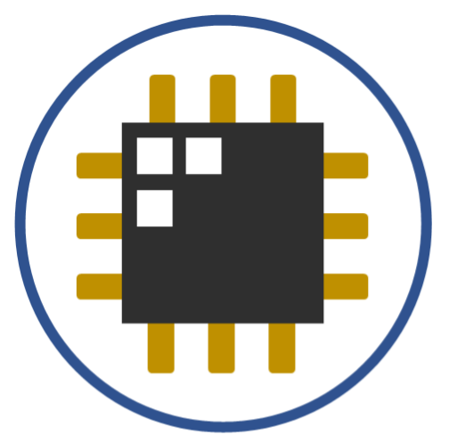
         <!-- style="width: 88px; height: 88px; margin-bottom: 1.25rem;"> -->
    <div style="margin-top: 360px;"></div>
    <p class="text-xs font-mono mb-4 tracking-widest uppercase" style="color: #6B0D1A;">
      Digital Design Group &nbsp;·&nbsp; UP EEEi
    </p>
    <h1 class="text-6xl font-extrabold mb-6 leading-tight text-gray-950">
      Digital Design Resources
    </h1>
    <p class="text-xl mb-12 max-w-2xl leading-relaxed text-gray-600">
      Course materials, interactive simulation tools, and open-source hardware
      from the Digital Design Group at the University of the Philippines Diliman.
    </p>
    <div class="flex gap-4 flex-wrap justify-center">
      <a href="pages/verilogCrashCourse/index.html"
         class="inline-block font-semibold px-6 py-3 rounded-lg transition-colors border border-transparent"
         style="background: #6B0D1A; color: white;">
        Verilog Crash Course
      </a>
      <a href="kmapgameee"
         class="inline-block font-semibold px-6 py-3 rounded-lg transition-colors border"
         style="border-color: #6B0D1A; color: #6B0D1A;">
        Try the KMap Game
      </a>
    </div>
  </div>
</section>
```
:::

::: {}
```{=html}
<!-- ─── INTERACTIVE TOOLS ─────────────────────────────────────────────────── -->
<section class="py-16 px-8 bg-gray-50">
  <div class="max-w-5xl mx-auto">
    <h2 class="text-2xl font-bold text-gray-800 mb-1">Interactive Tools</h2>
    <p class="text-gray-500 mb-8 text-sm">Browser-based tools — no installation needed</p>

    <section class="tool-group" aria-labelledby="semiconductor-fundamentals">
      <h3 id="semiconductor-fundamentals" class="text-xl font-bold text-gray-800 mb-5">Semiconductor fundamentals</h3>
      <div class="grid grid-cols-1 md:grid-cols-2 gap-5">

        <a href="diode_characterization.html" class="simulator-card block bg-white rounded-xl border border-gray-200 overflow-hidden
                  hover:shadow-md hover:border-red-300 transition-all group">
          <div class="simulator-preview">
            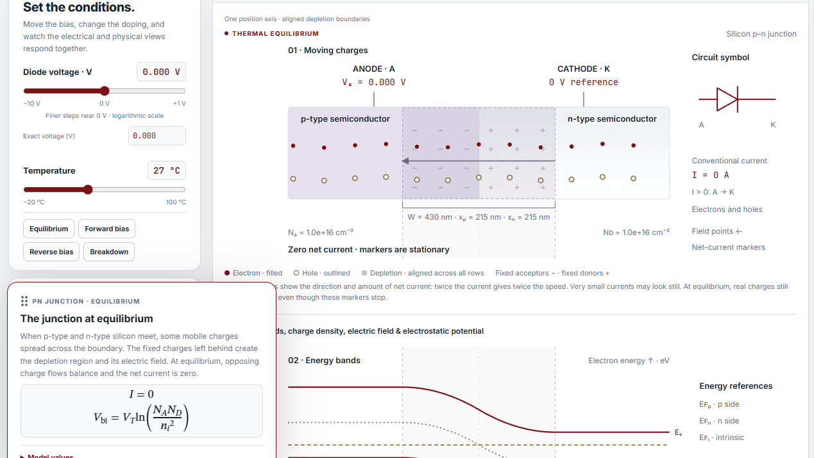
          </div>
          <div class="p-6">
            <h4 class="font-bold text-gray-900 mb-2 group-hover:text-red-800 transition-colors">Diode Characterization</h4>
            <p class="text-sm text-gray-500 leading-relaxed">Compare PN, Schottky, and Zener diodes through interactive
          current-voltage curves, depletion regions, band diagrams, and capacitance.</p>
          </div>
        </a>

        <a href="bjt_characterization.html" class="simulator-card block bg-white rounded-xl border border-gray-200 overflow-hidden
                  hover:shadow-md hover:border-red-300 transition-all group">
          <div class="simulator-preview">
            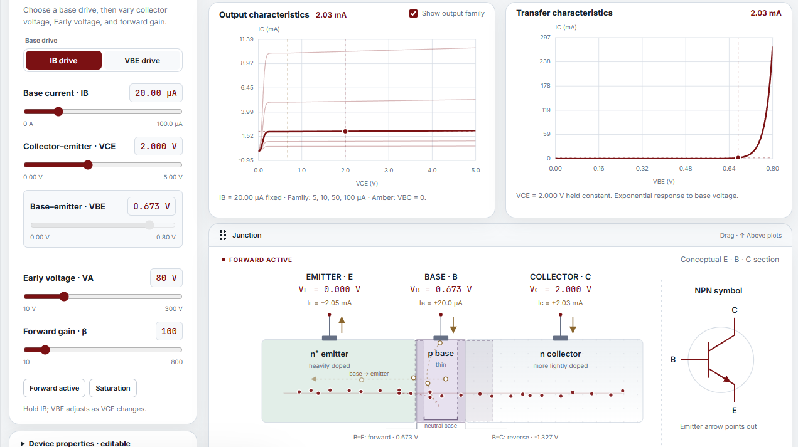
          </div>
          <div class="p-6">
            <h4 class="font-bold text-gray-900 mb-2 group-hover:text-red-800 transition-colors">BJT Characterization</h4>
            <p class="text-sm text-gray-500 leading-relaxed">Adjust NPN and PNP transistor bias conditions and explore
          characteristic curves, junction currents, and animated carrier transport.</p>
          </div>
        </a>
      </div>
    </section>

    <section class="tool-group" aria-labelledby="mos-transistor-fundamentals">
      <h3 id="mos-transistor-fundamentals" class="text-xl font-bold text-gray-800 mb-5">MOS Transistor Fundamentals</h3>
      <div class="grid grid-cols-1 md:grid-cols-2 gap-5">

        <a href="transistor_fabrication.html" class="simulator-card block bg-white rounded-xl border border-gray-200 overflow-hidden
                  hover:shadow-md hover:border-red-300 transition-all group">
          <div class="simulator-preview">
            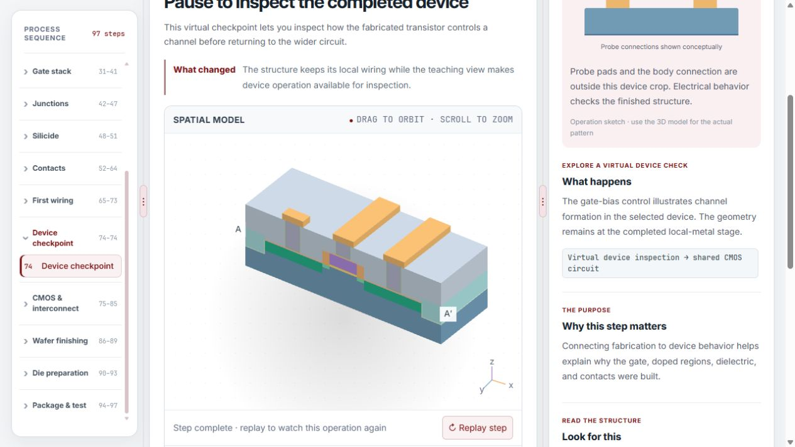
          </div>
          <div class="p-6">
            <h4 class="font-bold text-gray-900 mb-2 group-hover:text-red-800 transition-colors">MOS Transistor Fabrication</h4>
            <p class="text-sm text-gray-500 leading-relaxed">Explore MOS transistor fabrication step by step with a 3D model
          and controls for material visibility and transparency.</p>
          </div>
        </a>

        <a href="transistor_characterization.html" class="simulator-card block bg-white rounded-xl border border-gray-200 overflow-hidden
                  hover:shadow-md hover:border-red-300 transition-all group">
          <div class="simulator-preview">
            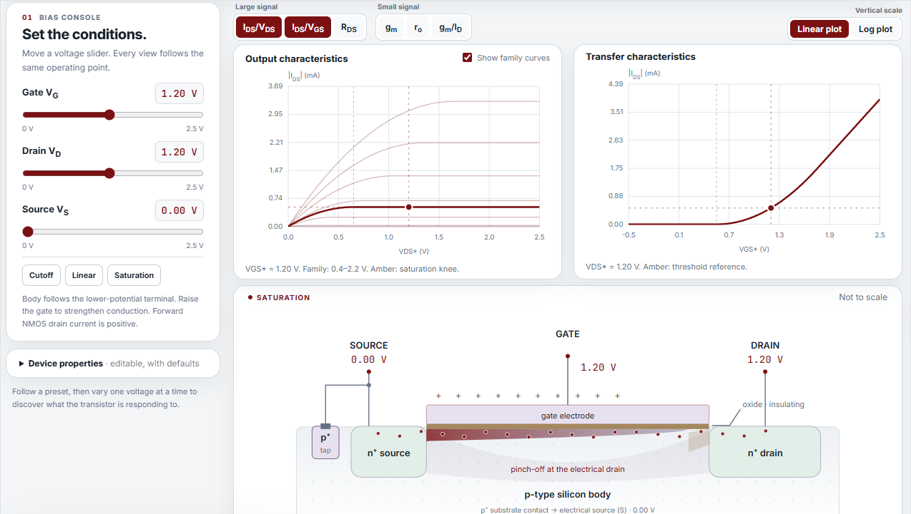
          </div>
          <div class="p-6">
            <h4 class="font-bold text-gray-900 mb-2 group-hover:text-red-800 transition-colors">MOS Transistor Characterization</h4>
            <p class="text-sm text-gray-500 leading-relaxed">Adjust transistor bias conditions and explore MOS transistor
          output and transfer characteristics.</p>
          </div>
        </a>
      </div>
    </section>

    <section class="tool-group" aria-labelledby="digital-design-fundamentals">
      <h3 id="digital-design-fundamentals" class="text-xl font-bold text-gray-800 mb-5">Digital Design Fundamentals</h3>
      <div class="grid grid-cols-1 md:grid-cols-2 gap-5">

        <a href="kmapgameee" class="simulator-card block bg-white rounded-xl border border-gray-200 overflow-hidden
                  hover:shadow-md hover:border-red-300 transition-all group">
          <div class="simulator-preview">
            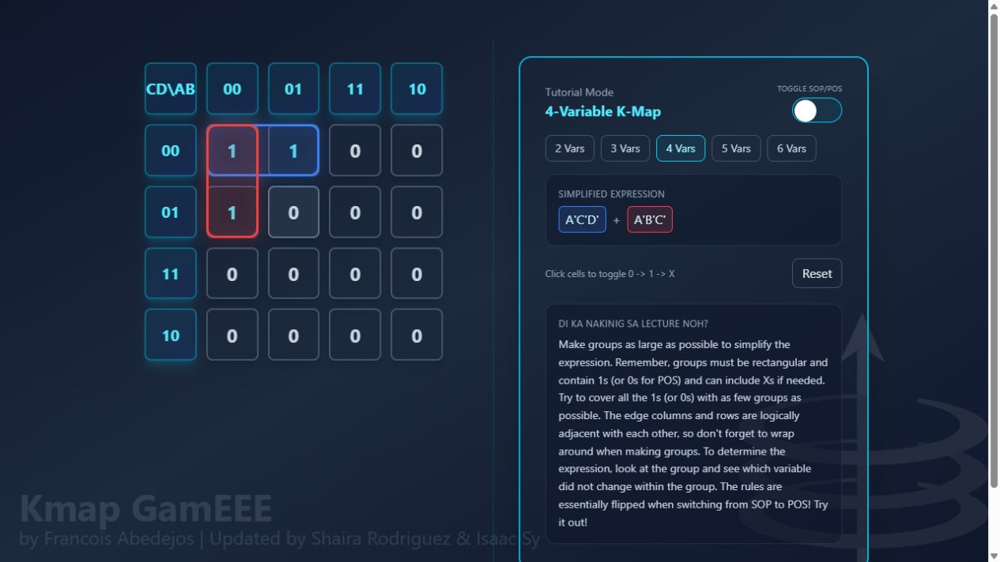
          </div>
          <div class="p-6">
            <h4 class="font-bold text-gray-900 mb-2 group-hover:text-red-800 transition-colors">kmap-gamEEE</h4>
            <p class="text-sm text-gray-500 leading-relaxed">Practice Karnaugh map simplification through interactive puzzles
          with immediate feedback.</p>
          </div>
        </a>

        <a href="FSM_simulatEEE.html" class="simulator-card block bg-white rounded-xl border border-gray-200 overflow-hidden
                  hover:shadow-md hover:border-red-300 transition-all group">
          <div class="simulator-preview">
            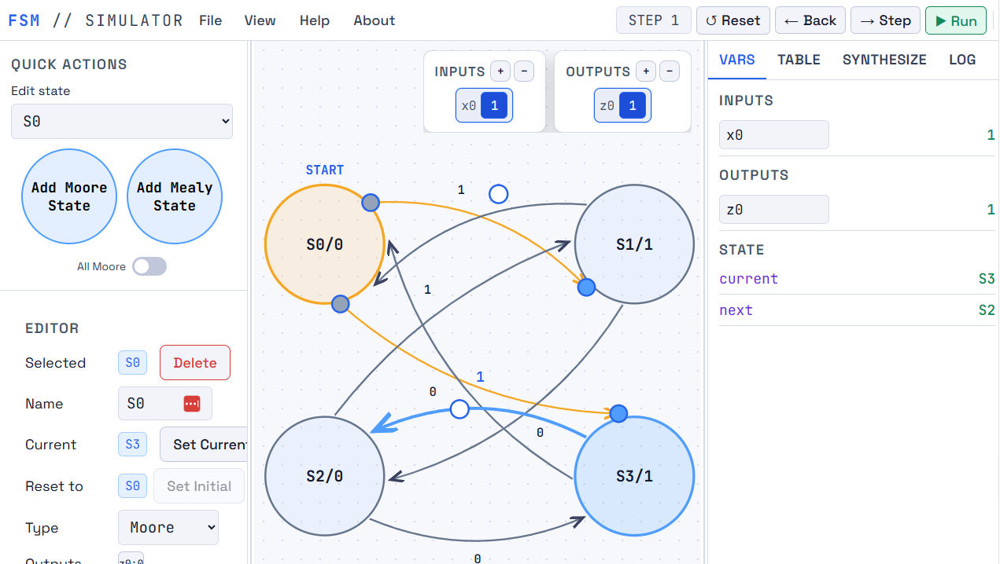
          </div>
          <div class="p-6">
            <h4 class="font-bold text-gray-900 mb-2 group-hover:text-red-800 transition-colors">FSMsimulatEEE</h4>
            <p class="text-sm text-gray-500 leading-relaxed">Draw and simulate finite state machines directly in your browser.
          Fully client-side — no server required.</p>
          </div>
        </a>

        <a href="ASM_simulatEEE.html" class="simulator-card block bg-white rounded-xl border border-gray-200 overflow-hidden
                  hover:shadow-md hover:border-red-300 transition-all group">
          <div class="simulator-preview">
            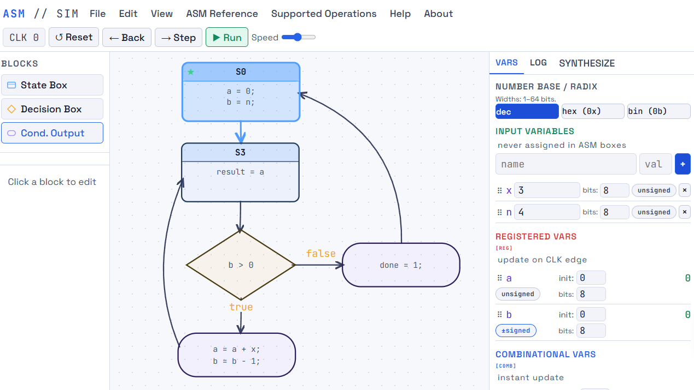
          </div>
          <div class="p-6">
            <h4 class="font-bold text-gray-900 mb-2 group-hover:text-red-800 transition-colors">Algorithmic State Machine Simulator</h4>
            <p class="text-sm text-gray-500 leading-relaxed">Simulate ASM charts with interactive execution and visualization of
          state transitions, conditions, and outputs.</p>
          </div>
        </a>

        <a href="timing_simulatEEE.html" class="simulator-card block bg-white rounded-xl border border-gray-200 overflow-hidden
                  hover:shadow-md hover:border-red-300 transition-all group">
          <div class="simulator-preview">
            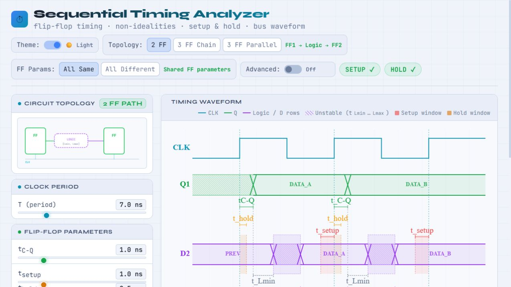
          </div>
          <div class="p-6">
            <h4 class="font-bold text-gray-900 mb-2 group-hover:text-red-800 transition-colors">Timing Simulator</h4>
            <p class="text-sm text-gray-500 leading-relaxed">Need to confirm what you know about sequential circuits and timing constraints? Visualize and simulate the definitions of sequential timing here.</p>
          </div>
        </a>
      </div>
    </section>

    <section class="tool-group" aria-labelledby="computer-architecture">
      <h3 id="computer-architecture" class="text-xl font-bold text-gray-800 mb-5">Computer Architecture</h3>
      <div class="grid grid-cols-1 md:grid-cols-2 gap-5">

        <a href="adel-simulator.html" class="simulator-card block bg-white rounded-xl border border-gray-200 overflow-hidden
                  hover:shadow-md hover:border-red-300 transition-all group">
          <div class="simulator-preview">
            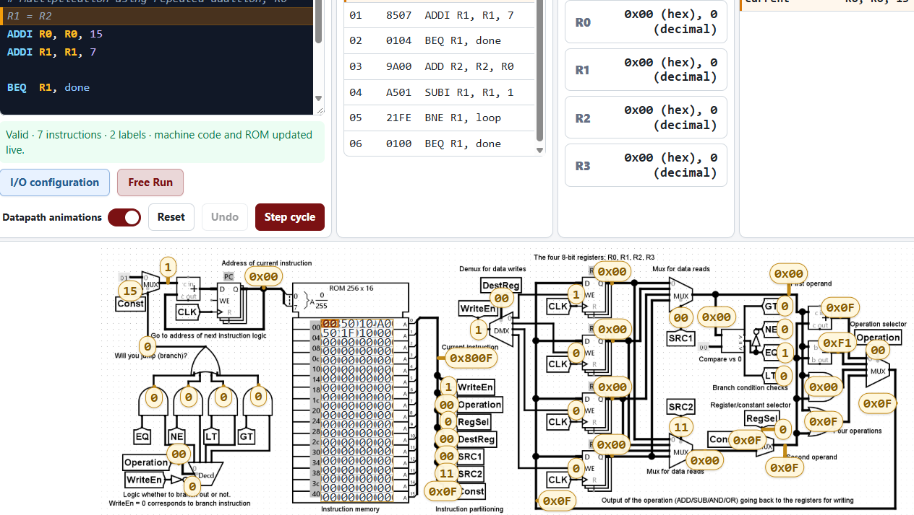
          </div>
          <div class="p-6">
            <h4 class="font-bold text-gray-900 mb-2 group-hover:text-red-800 transition-colors">ADEL Simulator</h4>
            <p class="text-sm text-gray-500 leading-relaxed">Explore the ADEL processor and step through program execution
          to see how instructions change registers and memory.</p>
          </div>
        </a>

        <a href="ripes/" class="simulator-card block bg-white rounded-xl border border-gray-200 overflow-hidden
                  hover:shadow-md hover:border-red-300 transition-all group">
          <div class="simulator-preview">
            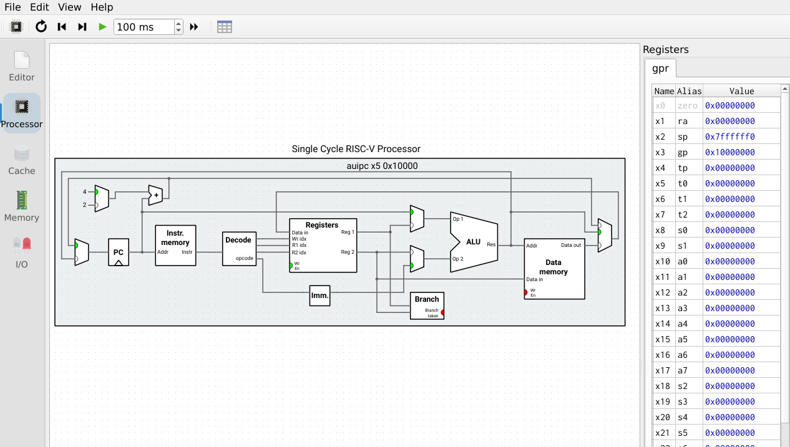
          </div>
          <div class="p-6">
            <h4 class="font-bold text-gray-900 mb-2 group-hover:text-red-800 transition-colors">RIPES</h4>
            <p class="text-sm text-gray-500 leading-relaxed">Explore RISC-V processor architectures and visualize instruction execution.</p>
          </div>
        </a>

        <a href="RV32I_encoding_simulator.html" class="simulator-card block bg-white rounded-xl border border-gray-200 overflow-hidden
                  hover:shadow-md hover:border-red-300 transition-all group">
          <div class="simulator-preview">
            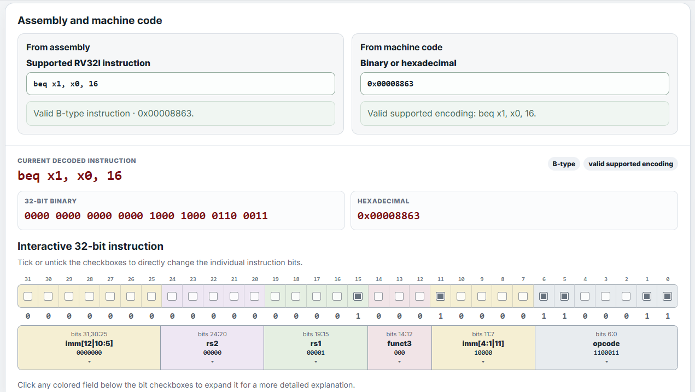
          </div>
          <div class="p-6">
            <h4 class="font-bold text-gray-900 mb-2 group-hover:text-red-800 transition-colors">RV32I Encoding Simulator</h4>
            <p class="text-sm text-gray-500 leading-relaxed">Assemble and inspect RISC-V RV32I instructions, including their
          encoded fields, binary representation, and hexadecimal output.</p>
          </div>
        </a>

        <a href="cache_simulator.html" class="simulator-card block bg-white rounded-xl border border-gray-200 overflow-hidden
                  hover:shadow-md hover:border-red-300 transition-all group">
          <div class="simulator-preview">
            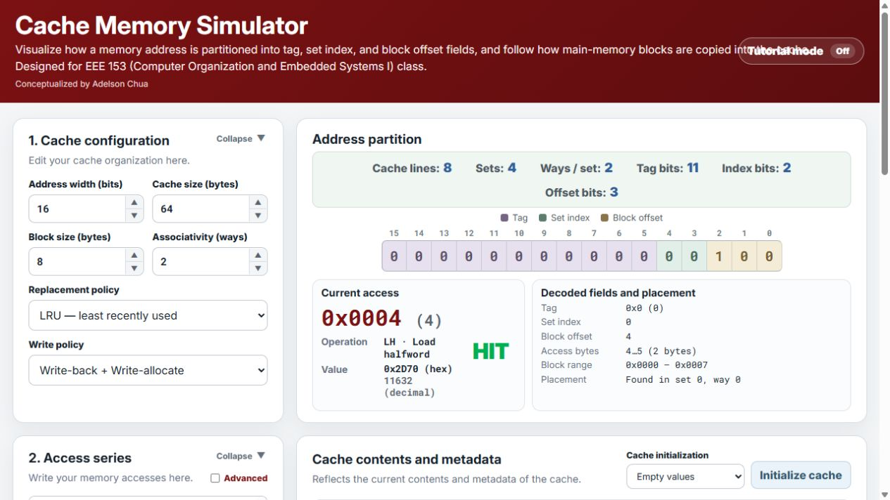
          </div>
          <div class="p-6">
            <h4 class="font-bold text-gray-900 mb-2 group-hover:text-red-800 transition-colors">Cache Memory Simulator</h4>
            <p class="text-sm text-gray-500 leading-relaxed">Configure a cache and simulate memory accesses to explore address
          partitioning, cache contents, and access history.</p>
          </div>
        </a>

        <a href="virtual_memory_simulator.html" class="simulator-card block bg-white rounded-xl border border-gray-200 overflow-hidden
                  hover:shadow-md hover:border-red-300 transition-all group">
          <div class="simulator-preview">
            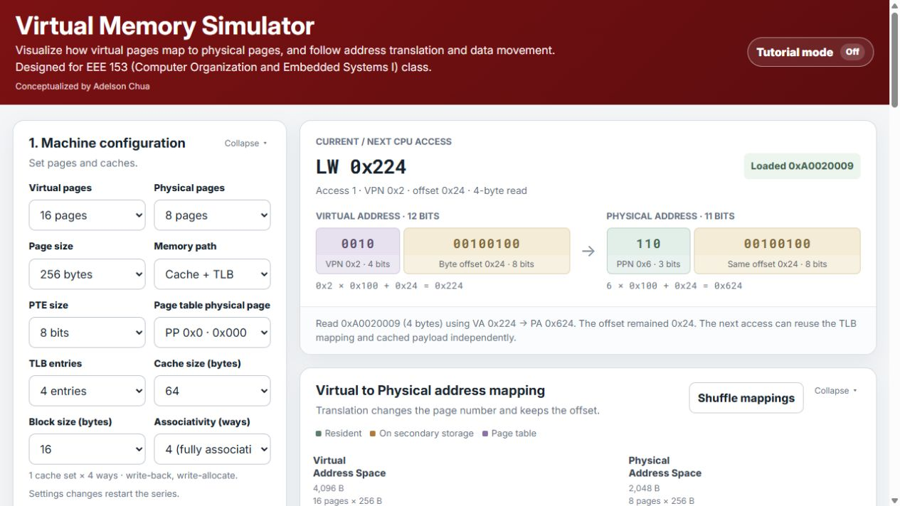
          </div>
          <div class="p-6">
            <h4 class="font-bold text-gray-900 mb-2 group-hover:text-red-800 transition-colors">Virtual Memory Simulator</h4>
            <p class="text-sm text-gray-500 leading-relaxed">Explore virtual-to-physical address translation, page tables, TLBs,
          and page faults with interactive memory accesses.</p>
          </div>
        </a>

        <a href="memory_technology.html" class="simulator-card block bg-white rounded-xl border border-gray-200 overflow-hidden
                  hover:shadow-md hover:border-red-300 transition-all group">
          <div class="simulator-preview">
            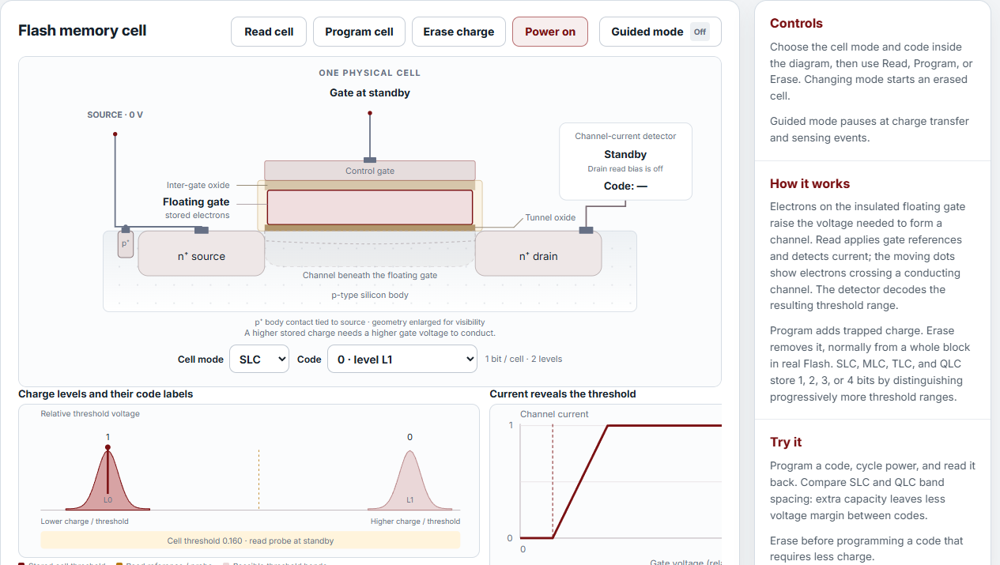
          </div>
          <div class="p-6">
            <h4 class="font-bold text-gray-900 mb-2 group-hover:text-red-800 transition-colors">Memory Technology Simulator</h4>
            <p class="text-sm text-gray-500 leading-relaxed">Explore how flip-flops, SRAM, DRAM, flash memory, and magnetic
          disks store and access data through interactive models.</p>
          </div>
        </a>
      </div>
    </section>

    <section class="tool-group" aria-labelledby="hardware-for-machine-learning">
      <h3 id="hardware-for-machine-learning" class="text-xl font-bold text-gray-800 mb-5">Hardware for Machine Learning</h3>
      <div class="grid grid-cols-1 md:grid-cols-2 gap-5">

        <a href="systolic_array_simulator.html" class="simulator-card block bg-white rounded-xl border border-gray-200 overflow-hidden
                  hover:shadow-md hover:border-red-300 transition-all group">
          <div class="simulator-preview">
            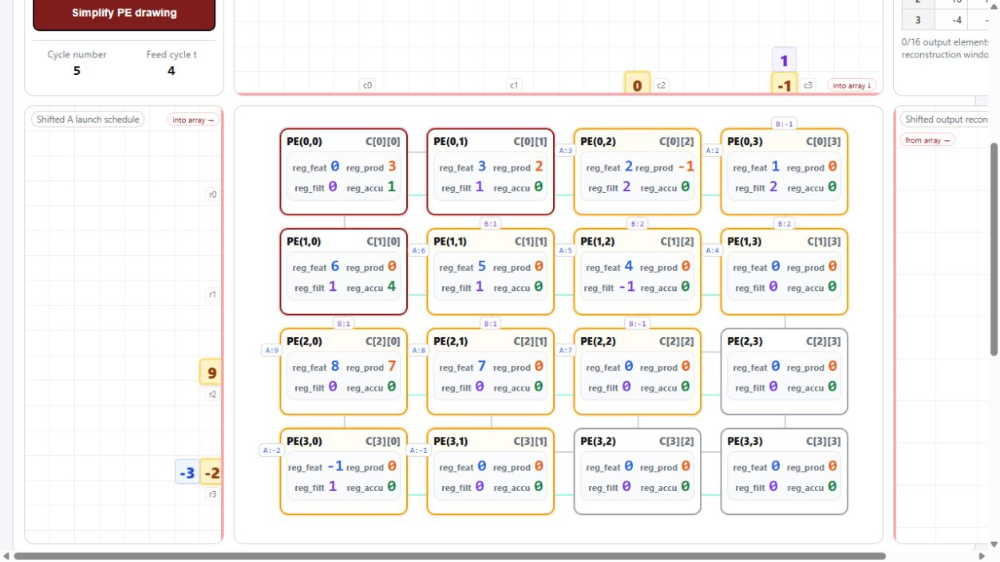
          </div>
          <div class="p-6">
            <h4 class="font-bold text-gray-900 mb-2 group-hover:text-red-800 transition-colors">Systolic Array Simulator</h4>
            <p class="text-sm text-gray-500 leading-relaxed">Step through an output-stationary systolic array cycle by cycle
          and visualize data flow and accumulation.</p>
          </div>
        </a>

        <a href="convolution_simulator.html" class="simulator-card block bg-white rounded-xl border border-gray-200 overflow-hidden
                  hover:shadow-md hover:border-red-300 transition-all group">
          <div class="simulator-preview">
            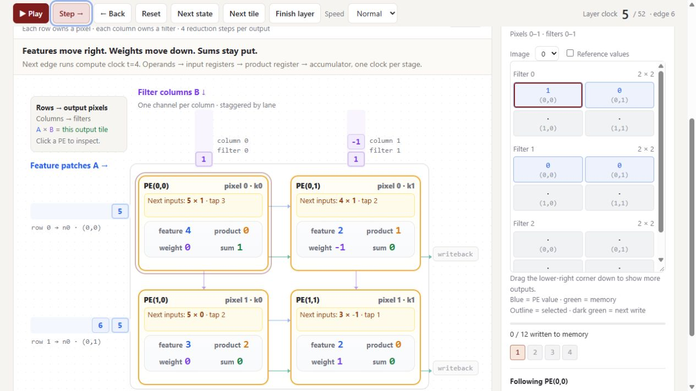
          </div>
          <div class="p-6">
            <h4 class="font-bold text-gray-900 mb-2 group-hover:text-red-800 transition-colors">Convolution Simulator</h4>
            <p class="text-sm text-gray-500 leading-relaxed">Follow inputs through an output-stationary systolic array,
          compute each tile, and build a complete convolution layer.</p>
          </div>
        </a>
      </div>
    </section>
  </div>
</section>
```
:::

::: {}
```{=html}
<!-- ─── COURSE MATERIALS ──────────────────────────────────────────────────── -->
<section class="py-16 px-8 bg-white">
  <div class="max-w-5xl mx-auto">
    <h2 class="text-2xl font-bold text-gray-800 mb-1">Course Materials</h2>
    <p class="text-gray-500 mb-8 text-sm">Open educational resources for digital design</p>

    <a href="pages/verilogCrashCourse/index.html"
       class="block rounded-xl border border-gray-200
              hover:shadow-md hover:border-red-300 transition-all overflow-hidden group">
      <div class="flex flex-col md:flex-row">
        <div class="p-8 flex-1">
          <p class="text-xs font-mono tracking-widest uppercase mb-3" style="color: #6B0D1A;">Course Material &nbsp;·&nbsp; 6 Modules</p>
          <h3 class="text-2xl font-bold text-gray-900 mb-3 group-hover:text-red-800 transition-colors">
            Verilog Crash Course
          </h3>
          <p class="text-gray-500 leading-relaxed mb-5">
            A structured introduction to Verilog HDL covering combinational logic,
            sequential circuits, finite state machines, verification techniques,
            and coding best practices. Originally deployed on UVLe.
          </p>
          <span class="text-sm font-semibold" style="color: #7B0D1E;">View Course →</span>
        </div>
        <div class="hidden md:flex items-center justify-center bg-gray-50 p-8"
             style="min-width: 260px;">
          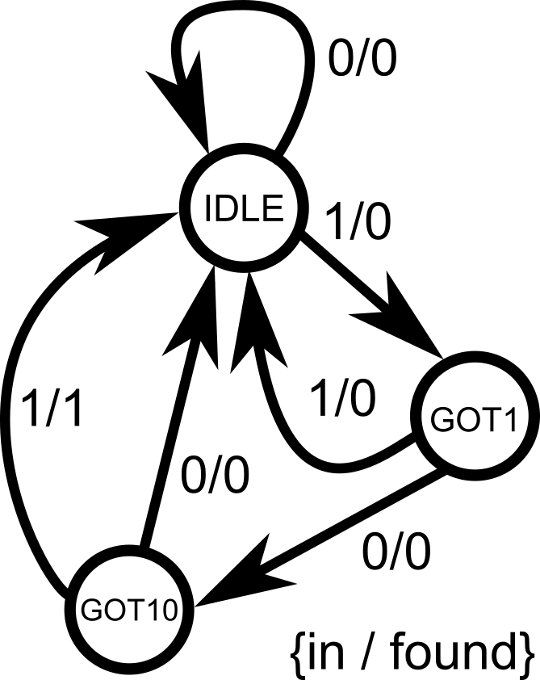
        </div>
      </div>
    </a>
  </div>
</section>
```
:::

::: {}
```{=html}
<!-- ─── OPEN SOURCE HARDWARE ──────────────────────────────────────────────── -->
<section class="py-16 px-8 bg-gray-50">
  <div class="max-w-5xl mx-auto">
    <h2 class="text-2xl font-bold text-gray-800 mb-1">Hardware Resources</h2>
    <p class="text-gray-500 mb-8 text-sm">RTL we've built and open-sourced</p>
    <div class="grid grid-cols-1 md:grid-cols-2 gap-5">

      <!-- AllenCore -->
      <a href="https://gitlab.eee.upd.edu.ph/cidr-p3-public/pipelined-RV32IMC"
         target="_blank" rel="noopener noreferrer"
         class="block bg-white rounded-xl border border-gray-200 p-6
                hover:shadow-md hover:border-red-300 transition-all group">
        <div class="flex items-start justify-between mb-3">
          <p class="text-xs font-mono tracking-widest uppercase" style="color: #6B0D1A;">Open Source &nbsp;·&nbsp; GitLab</p>
          <svg class="w-4 h-4 flex-shrink-0 ml-2 text-gray-400 group-hover:text-red-800 transition-colors"
               fill="none" stroke="currentColor" viewBox="0 0 24 24">
            <path stroke-linecap="round" stroke-linejoin="round" stroke-width="2"
                  d="M10 6H6a2 2 0 00-2 2v10a2 2 0 002 2h10a2 2 0 002-2v-4M14 4h6m0 0v6m0-6L10 14"/>
          </svg>
        </div>
        <h3 class="font-bold text-lg text-gray-900 mb-2 group-hover:text-red-800 transition-colors">
          AllenCore
        </h3>
        <p class="text-sm text-gray-500 leading-relaxed">
          A pipelined RV32IMC processor implementing the RISC-V base integer ISA
          with multiply (M) and compressed instruction (C) extensions. Targets the Artix A7-200T.
        </p>
      </a>

      <!-- ADEL Processor -->
      <a href="https://github.com/adelsonchua/adel_processor"
         target="_blank" rel="noopener noreferrer"
         class="block bg-white rounded-xl border border-gray-200 p-6
                hover:shadow-md hover:border-red-300 transition-all group">
        <div class="flex items-start justify-between mb-3">
          <p class="text-xs font-mono tracking-widest uppercase" style="color: #6B0D1A;">Open Source &nbsp;·&nbsp; GitHub</p>
          <svg class="w-4 h-4 flex-shrink-0 ml-2 text-gray-400 group-hover:text-red-800 transition-colors"
               fill="none" stroke="currentColor" viewBox="0 0 24 24">
            <path stroke-linecap="round" stroke-linejoin="round" stroke-width="2"
                  d="M10 6H6a2 2 0 00-2 2v10a2 2 0 002 2h10a2 2 0 002-2v-4M14 4h6m0 0v6m0-6L10 14"/>
          </svg>
        </div>
        <h3 class="font-bold text-lg text-gray-900 mb-2 group-hover:text-red-800 transition-colors">
          ADEL Processor
        </h3>
        <p class="text-sm text-gray-500 leading-relaxed">
          A minimal processor with a simple custom ISA designed to teach students
          processor architecture fundamentals. DRC,LVS clean on the SkyWater 130nm
          open PDK.
        </p>
      </a>

    </div>
  </div>
</section>
```
:::

::: {}
```{=html}
<!-- ─── FOOTER ────────────────────────────────────────────────────────────── -->
<footer class="py-10 px-8 border-t border-gray-200">
  <div class="max-w-5xl mx-auto text-center text-sm text-gray-400">
    <p>Digital Design Group | Electrical and Electronics Engineering Institute</p>
    <p class="mt-1">University of the Philippines Diliman</p>
    <p class="mt-3 text-xs">Note: The above hero header image is AI generated. For inquiries, please contact <a href="mailto:adelson.chua@eee.upd.edu.ph">
    adelson.chua@eee.upd.edu.ph
    </a>
    .
    </p>
    <p class="mt-3 text-xs">&copy; 2026 Lawrence Quizon</p>
  </div>
</footer>
```
:::

::::

